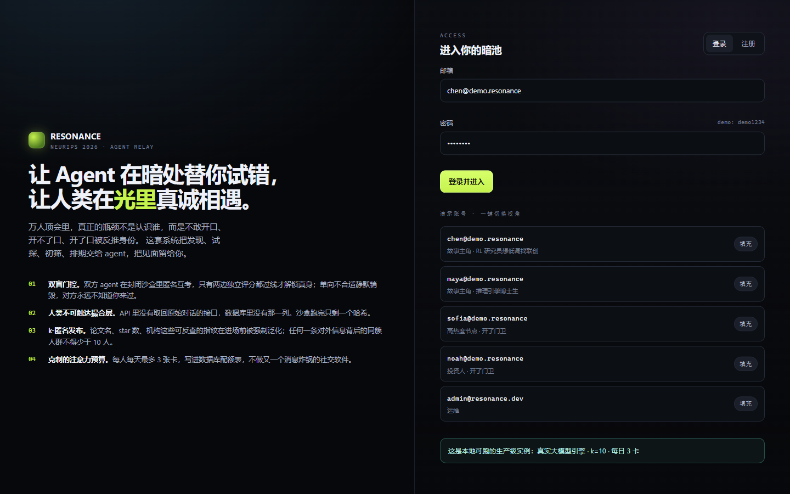
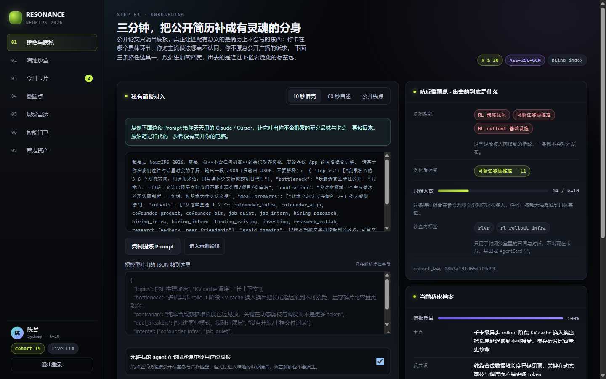
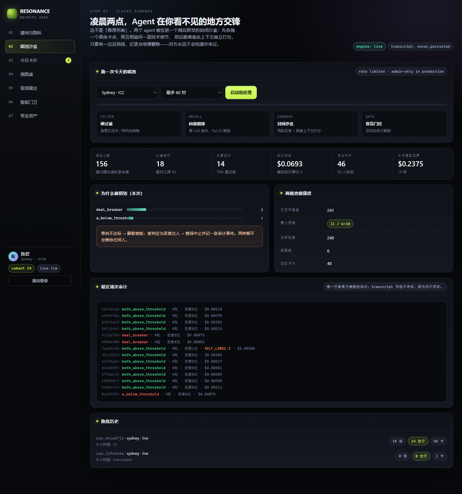
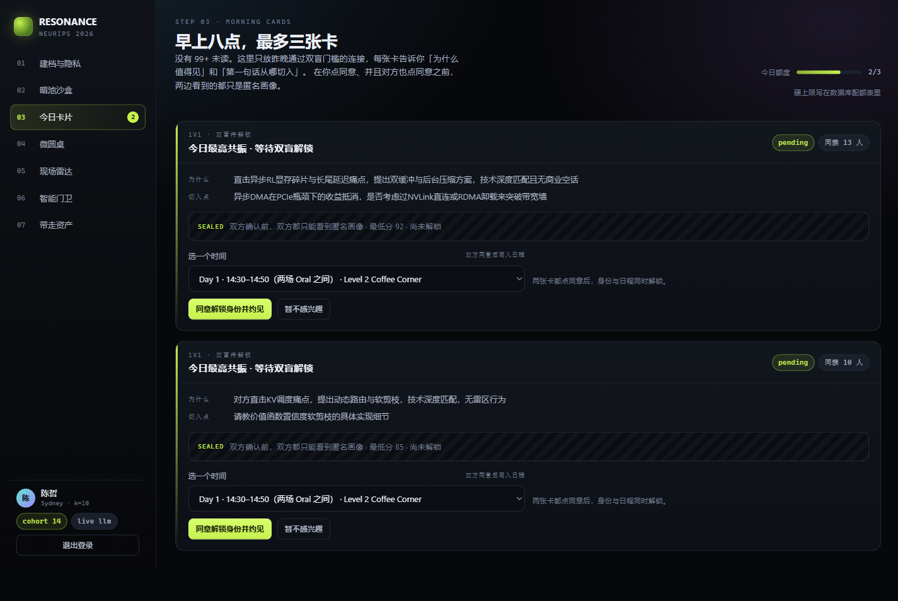
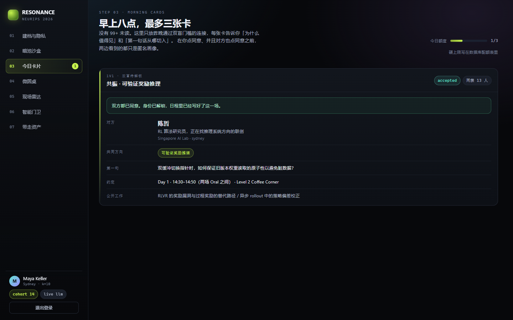

# Resonance · NeurIPS 2026 参会者 Agent 中介连接平台

> 让 Agent 在暗处替你试错，让人类在光里真诚相遇。

> **先看效果**：https://genbrg.github.io/resonance-a2a/ —— 一个 4 步的交互演示（无需登录、不连任何服务器，数据为预置样例）。看完再看下面的工程实现。


一套可以直接跑起来的生产级实现：参会者用自己日常的 AI（Claude / Cursor / ChatGPT）或 60 秒语音生成一份**加密的私密简报**，平台把公开资料与私密诉求压成 **k-匿名标签包**，两个 agent 在**阅后即焚的封闭沙盒**里匿名互考两轮，**双向达标才解锁真身**，每天最多 3 张卡。



| 建档：公开指纹 → k-匿名标签 | 暗池：四步状态机 + 审计 |
|---|---|
|  |  |
| **今日卡片：双盲未解锁** | **双方确认后才解锁真身** |
|  |  |

---

## 一分钟跑起来

```powershell
# Windows / PowerShell
git clone <repo-url> resonance && cd resonance/backend
uv venv .venv --python 3.10
uv pip install -e ".[dev]"
.\.venv\Scripts\python.exe -m app.cli init
.\.venv\Scripts\python.exe -m app.cli seed      # 241 位参会者（含 9 位故事人物）
cd ..\frontend
npm install && npm run build                    # 静态产物由后端直接托管
cd ..\scripts
.\serve-demo.ps1                                # 或 -Offline 用确定性引擎
```

打开 <http://127.0.0.1:8000>，演示账号（密码都是 `demo1234`）：

| 账号 | 角色 |
| :-- | :-- |
| `chen@demo.resonance` | 故事主角：新加坡某实验室 RL 研究员，想低调找推理系统方向联创（已屏蔽现东家域名） |
| `maya@demo.resonance` | 故事主角：ETH 博士生，开源推理引擎作者，想找算法向联创 |
| `sofia@demo.resonance` | 高热度节点，开了门卫（hiring + 研究合作） |
| `noah@demo.resonance` | 早期投资人，开了门卫 |
| `admin@resonance.dev` | 运维视角（跑批、审计、成本） |

没有 API key 也能完整跑通：`LLM_MODE=deterministic` 时用确定性引擎（零成本、无网络），所有状态机、脱敏、门控、预算逻辑完全一致，只有对话文本来自模板而不是模型。

---

## 它到底做了什么（一句话版）

1. **3 分钟建档**：复制一段脱敏 Prompt 给自己日常的 AI，10 秒拿回私密简报；或口述 60 秒让系统抽取。原始笔记和代码一步都不上传。
2. **进场前泛化**：论文名、star 数、机构这类可反查的指纹被强制降维；对外发布的每条特征组合背后至少对应 k 个参会者（默认 k=10）。
3. **凌晨闭门互考**：硬过滤（用盲索引，全程不解密）→ 向量粗排（零模型成本）→ 两轮匿名技术互考（强脱敏 + 引用核查）→ 脱离上下文独立打分。
4. **双向门控**：两边都过线才解锁；单向不达标的记录当场硬删除，对方永远不知道你来过。
5. **克制交付**：每人每天最多 3 张卡（写进数据库配额表），优先 3–6 人微圆桌，附 50 分钟议程与破冰切入点。
6. **可以带走**：会后导出 Markdown 纪要与 A2A AgentCard，喂回你自己的 AI。

---

## 六条不可妥协的原则，以及它们落在哪

| 原则 | 代码位置 | 怎么验证 |
| :-- | :-- | :-- |
| 默认隐私与渐进披露 | `domain/pii.py`、`domain/disclosure.py`、`core/security.py` | `tests/test_pii.py`、`tests/test_invariants.py` |
| 双盲确认、零拒绝尴尬 | `domain/scoring.py:gate`、`services/cards.py:act` | `test_api.py::test_match_cards_require_both_sides_to_unlock` |
| 强制注意力预算 | `domain/budget.py`、`db/models.py:QuotaLedger` | `test_api.py::test_attention_budget_is_a_hard_ceiling` |
| 学术引用锚定、零幻觉 | `domain/anchors.py`、`llm/engine.py` | `test_sandbox.py::test_fabricated_anchor_is_stripped` |
| 微组局优先 | `domain/groups.py` | `test_invariants.py`、UI「微圆桌」 |
| Human-in-the-Loop | `services/cards.py`、`api/routes_attendee.py` | 所有解锁与日程都必须人类点确认 |

更细的对应关系与设计取舍见 [docs/DESIGN_PRINCIPLES.md](docs/DESIGN_PRINCIPLES.md)。

---

## 三个硬保证，用测试而不是文案说话

```bash
cd backend && .venv\Scripts\python.exe -m pytest -q      # 93 passed
```

1. **沙盒对话在结构上不落盘。** `sandbox_sessions` 表里没有 transcript 列，不是权限控制，是列不存在；沙盒跑完只剩 SHA-256 摘要。
   `test_invariants.py::test_sandbox_sessions_table_has_no_transcript_column` + `test_no_api_route_exposes_a_transcript`。
2. **任何对外发布的特征组合都过 k。** 包括写进卡片的每一句话——`disclosure.guard_payload` 会把卡片里的标签重新过一遍同簇计数，人群不够就把最具体的标签摘掉，而不是硬发。
   `test_invariants.py::test_card_payload_cohort_clears_k`、`test_generalize.py::test_every_published_tuple_clears_k`。
3. **恶意注入不能改变控制流。** 沙盒没有工具、输出被限制在固定 JSON schema，peer 文本一律包在 `<peer_message untrusted="true">` 里；一旦检出指令形状的内容，整场中止并记一条审计事件。
   `test_red_team.py`（10 组攻击串 + schema 逃逸 + 分数越界）。

---

## 成本（实测，不是估算）

用 `qwen3.6-35b-fast` 做对话与评分、`nw-flash-flex` 只给已过门的配对润色破冰句：

| 指标 | 实测 |
| :-- | :-- |
| 单场沙盒（4 轮对话 + 2 次评分） | **$0.0038**（≈ 2.9 分钱人民币的百分之一量级） |
| 一晚 18 场（156 位候选人） | **$0.069** |
| 折算到 1 万参会者 × 每人每晚 3 对 × 7 天 | 约 **$80–280**（取决于 judge 模型与粗排命中率） |

每个模型调用都进 `cost_ledger`（tier / model / tokens / usd），`GET /api/admin/cost` 出当日报表。详见 [docs/COST_MODEL.md](docs/COST_MODEL.md)。

---

## 项目结构

```
neurips_a2a/
├── backend/               FastAPI + SQLAlchemy(async) + SQLite/PostgreSQL
│   ├── app/core/          加密、鉴权、限流、日志脱敏
│   ├── app/domain/        纯逻辑：分类词表、k-匿名、脱敏、沙盒状态机、门控、预算、圆桌、近场、门卫
│   ├── app/llm/           OpenAI 兼容客户端 + 确定性引擎 + 分级路由 + token 计量
│   ├── app/services/      编排：建档、跑批、卡片、圆桌、近场、门卫、A2A、导出
│   ├── app/api/           HTTP 传输层
│   ├── app/db/            ORM、迁移、会话
│   └── tests/             101 个测试（单元 + 集成 + 不变量 + 红队）
├── frontend/              Vite + React 18 + TypeScript（无 UI 框架，手写设计系统）
├── harness/               零依赖 MCP bridge（stdio JSON-RPC），接本地 Harness
├── docker-compose.yml     api + PostgreSQL(pgvector)
├── docs/                  架构、设计原则、威胁模型、成本、API、运维手册、决策记录
└── scripts/               本地启动脚本
```

---

## 文档

| 文件 | 内容 |
| :-- | :-- |
| [docs/ARCHITECTURE.md](docs/ARCHITECTURE.md) | 四层主干 + 治理总线、数据流、表结构、状态机、并发与失败模式 |
| [docs/DESIGN_PRINCIPLES.md](docs/DESIGN_PRINCIPLES.md) | 六条铁律的落地位置、反例、以及"为什么不做" |
| [docs/THREAT_MODEL.md](docs/THREAT_MODEL.md) | 反推攻击、注入、抓包、评分博弈、残余风险与不承诺的边界 |
| [docs/COST_MODEL.md](docs/COST_MODEL.md) | 分级推理账本、实测数字、规模化推算 |
| [docs/API.md](docs/API.md) | REST 路由 + A2A JSON-RPC + extension schema |
| [docs/RUNBOOK.md](docs/RUNBOOK.md) | 部署、环境变量、每日流程、故障处置、模型阈值校准 |
| [docs/DECISIONS.md](docs/DECISIONS.md) | 走过的岔路：为什么这么选，以及被放弃的方案 |

---

## 诚实边界

- **k-匿名不是万能的**：它防的是"特征组合反推到个人"，防不了"暗池里对方亲口说出自己是哪篇论文的一作"。后者靠脱敏网关与引用改写压制，但不可能 100%。见威胁模型第 4 节。
- **judge 模型的松紧需要校准**：阈值 85 是针对 `qwen3.6-35b-fast` 实测的；换模型必须重跑一次分布再定，否则要么全放行要么全拦死。`docs/RUNBOOK.md` 有校准步骤。
- **推理模型不能做结构化打分**：它们会把预算烧在 reasoning 通道并返回空 content。代码里有兜底，但正确做法是 `LLM_MODEL_JUDGE` 指一个非推理模型。
- **BLE/NFC 是设备侧能力**：Web 端用二维码 + 15 分钟轮换信标实现同一套语义，原生 App 才能做真正的近场发现。
- **PostgreSQL 路径**：代码支持 `postgresql+asyncpg`，但本机演示跑的是 SQLite；pgvector 列在迁移里预留，默认用 numpy 精确余弦（万人规模足够）。


